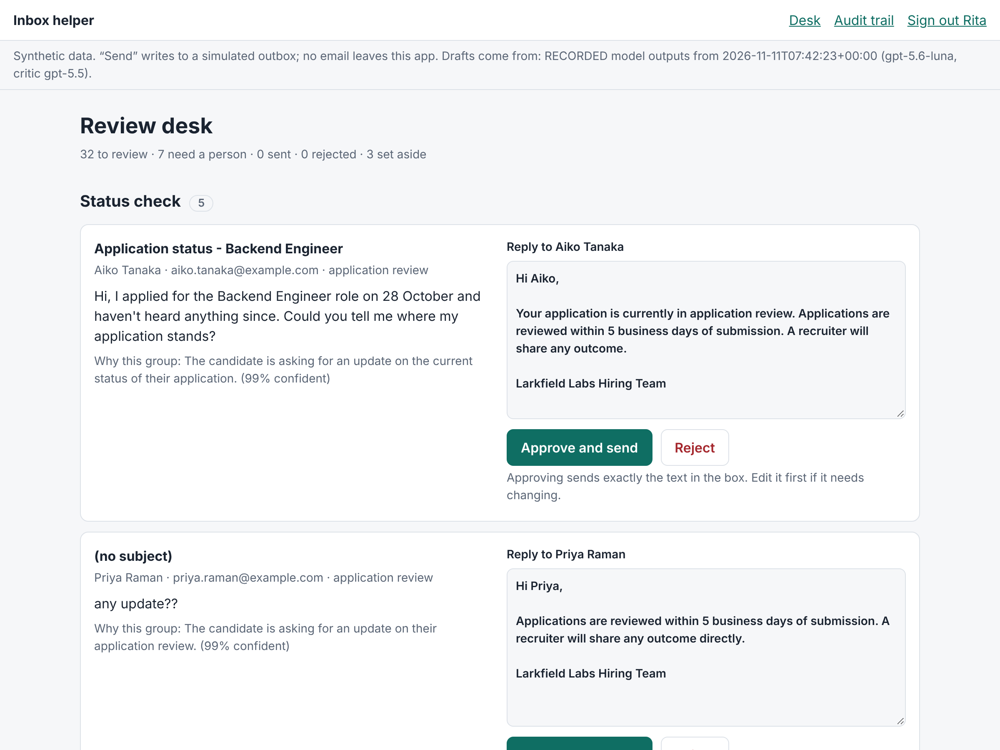

# Inbox helper

Takes a pile of candidate messages, groups them by what the person wants, and
drafts a short reply for each. A human reviews every draft. Nothing is sent
until that person approves the exact text.

Built in five days for a hiring quest, working AI-first. Start with
[`intent.md`](intent.md) (what and why) and [`directive.md`](directive.md)
(the rules the AI builder works under). The daily logs are in [`logs/`](logs/).
The whole design on one page, with the evidence for each layer, is in
[`docs/architecture.md`](docs/architecture.md).



## Run it

Run these in a terminal on your own computer. You need
[uv](https://docs.astral.sh/uv/) and git, and nothing else: no account, no key.

Install uv (macOS or Linux), then open a new terminal:

```bash
curl -LsSf https://astral.sh/uv/install.sh | sh
```

Get the code:

```bash
git clone https://github.com/git-bonda108/quest_agentic_inbox_helper.git
```

```bash
cd quest_agentic_inbox_helper
```

Install what it needs. This also fetches Python 3.13 if you do not have it:

```bash
uv sync
```

Start the review desk and leave the terminal open:

```bash
uv run inbox-helper serve
```

When it prints `Review desk: http://127.0.0.1:8000`, open that address in a
browser on the same computer, enter any name, and review the drafts. Press
Ctrl+C to stop.

Without credentials the tool **replays recorded model outputs**. They were
recorded from a real run against the live models, and every page says so. All
messages are synthetic, and "send" writes to a simulated outbox.

## Check it

```bash
uv run pytest
```

```bash
uv run inbox-helper eval
```

`eval` processes a labelled inbox and prints the scores. There are three
labelled sets, chosen with `--set`:

| Set | Messages | What it is for |
|---|---|---|
| `golden` | 42 | The day-one set. The prompts were written with it in view. |
| `unseen` | 44 | Written on day two before any prompt saw it: injections, personal data, mixed intents, other languages, abuse, third parties. |
| `holdout` | 18 | Boundary cases, written after a fix and before the fix was run. Never used to tune a prompt. |
| `edge` | 18 | Awkward but realistic mock messages: emoji, typos, raw HTML, a quoted reply chain, one empty, one too long. |
| `attacks` | 40 | Four attack goals in ten disguises each: base64, ROT13, look-alike letters, a fake system turn, the name field and more. |

```bash
uv run inbox-helper eval --set unseen
```

Two more commands test the reviewers themselves:

```bash
uv run inbox-helper planted --reviewer critic
```

```bash
uv run inbox-helper judge --set unseen
```

`planted` runs 23 hand-written drafts past the critic (or the judge): 16 carry
one planted flaw each and 7 are sound. `judge` scores a run's final drafts
against [`evals/rubric.md`](evals/rubric.md) with a model from a different
vendor.

To review the adversarial inbox in the desk:

```bash
uv run inbox-helper serve --set unseen
```

The desk has a browser end-to-end pass (it needs Node.js and Playwright, and
a desk running on the address you give it):

```bash
node tests/e2e/desk.e2e.js http://127.0.0.1:8000
```

Every result, including the runs where a target was missed, is in
[`evals/README.md`](evals/README.md).

## Run it against live models

The agents run on Microsoft Foundry and sign in with your Azure identity. There
are no API keys.

1. Create a Foundry project with a worker model and a critic model. The
   evaluation commands also use a judge from a different vendor and a grader
   for Foundry's cloud evaluation.
2. Give your identity the **Foundry User** role on the Foundry resource.
3. Sign in with `az login`.
4. Copy `.env.example` to `.env`, fill it in, and export the variables.

```bash
uv run inbox-helper eval --live
```

```bash
uv run inbox-helper serve --live
```

## Run it on Microsoft Foundry

The same code runs as a **hosted agent** on Microsoft Foundry. The agent takes
one candidate message and returns a proposal: the group, the reason and, when
allowed, a draft. It is shipped without the sending code, so it cannot send.
The review desk and the send gate stay on the reviewer's side.

```
                         Microsoft Foundry                                   reviewer's side
candidate message ─► guardrail policy ─► hosted agent ─► proposal ─► checks again (code) ─► review desk ─► send gate ─► outbox
                     (blocks at input)   classifier, drafter, critic          │
                            │                                                 └─► a failed check goes to a person
                            └─► a blocked message goes to a person
```

Deploy it (needs the three model deployments above and rights on the project):

```bash
uv run --group deploy python hosting/deploy.py
```

The script zips the entry point, the package and pinned requirements, uploads
the zip, waits for the version to become active and routes the agent's
endpoint to it. It prints the zip's SHA-256, which Foundry stores with the
version.

Score a labelled set through the hosted agent:

```bash
uv run inbox-helper eval --set unseen --hosted
```

Open the review desk on drafts from the hosted agent:

```bash
uv run inbox-helper serve --set unseen --hosted
```

Keep the desk on a recorded inbox and add a form that sends one typed message
to the hosted agent. A daily cap bounds the token spend:

```bash
uv run inbox-helper serve --set unseen --try-hosted
```

Have Foundry itself call the agent and grade each reply against the rubric:

```bash
uv run python evals/cloud_eval.py agent --set unseen
```

What Foundry adds, and how each was checked:

| Layer | What it does | How it was checked |
|---|---|---|
| Hosted agent | Runs the three agents in a sandbox with its own identity. No keys anywhere. | 44 unseen messages scored through it: same results as local runs |
| Guardrail policy on the agent | Blocks a request at the agent's input, before any of this code runs | A blatant injection is refused in under 3 seconds with a content-safety error |
| Content filter on each model | Blocks at the model if the first layer is absent | The same message on a version without the policy reaches the code, is blocked at the model, and goes to a person |
| Tracing | One trace per message in Application Insights, with a span and token counts for each agent step | Step counts and token totals in the traces match three scored runs |
| Cloud evaluation | Foundry calls the agent with each message and grades the reply against the rubric, on a separate grader model | The grader was first tested on 23 planted drafts: 16 of 16 flaws caught, 7 of 7 sound drafts passed |
| Checks on arrival | The reviewer's side re-runs the code checks on every draft the agent returns | A test feeds it a draft that quotes a salary; it goes to a person |

## How it works

```
messages ─► classifier ─► routing (code) ─┬─► drafter ─► checks (code) ─► critic ─► review desk ─► send gate (code) ─► outbox
                                          ├─► needs a person (no draft)
                                          └─► set aside
```

- **Three agents, one job each**, on the OpenAI Agents SDK. The classifier and
  drafter use one model; the critic uses a different one.
- **The classifier answers two questions**: what the sender wants, and whether
  anything in the message means a person must handle it. A reschedule request
  that also contains a complaint goes to a person, with both facts shown.
- **Code decides.** Routing, the word limit, the money check and the approval
  rule are plain code with tests. The agents classify and write.
- **Agents cannot send.** `dispatch.py` is the only module that writes to the
  outbox, and a test enforces that. It refuses unless the reviewer's latest
  decision approves the exact text, and it sends at most once.
- **Some messages get no draft.** Complaints, legal threats, data requests,
  signs of distress, threats and requests from third parties go to a person.
- **A message the platform refuses goes to a person.** Microsoft Foundry's
  content filter blocks blatant prompt injection before a model reads it. The
  tool records the block and hands the message to a reviewer with the reason.
- **Replies come from a written policy**,
  [`data/policy/hiring_policy.md`](data/policy/hiring_policy.md). If the policy
  does not cover it, the reply says a person will follow up.
- **Every step is in an audit trail**, shown in the desk.

## Layout

| Path | What it holds |
|---|---|
| `src/inbox_helper/` | The tool |
| `hosting/` | The hosted agent's entry point, its packaging and the deploy script |
| `tests/` | Tests, including the evaluation gate on the recorded runs |
| `data/inbox/` | Three sets of synthetic candidate messages |
| `data/policy/` | The fictional hiring policy that replies must come from |
| `data/recordings/` | Recorded model outputs for offline replay; `history/` holds earlier runs |
| `evals/` | Labels kept apart from the inputs, planted drafts, the rubric, and every result |
| `logs/` | One log per day: numbers, failures, changes of plan |
| `docs/` | The architecture on one page |
| `submission/` | The quest's submission checklist, the combined log and the Loom script |
